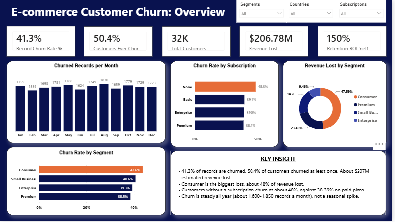
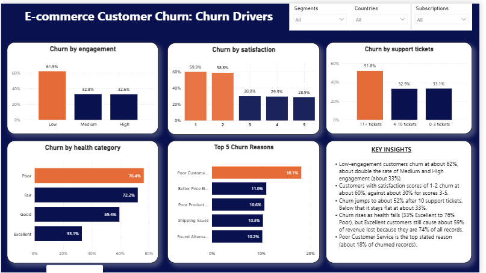
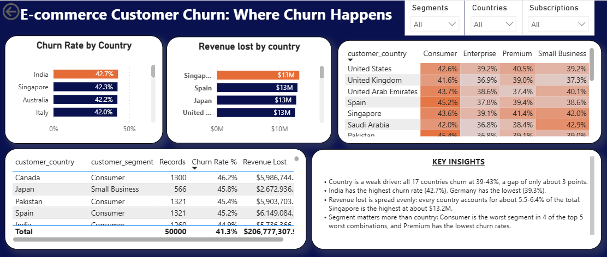
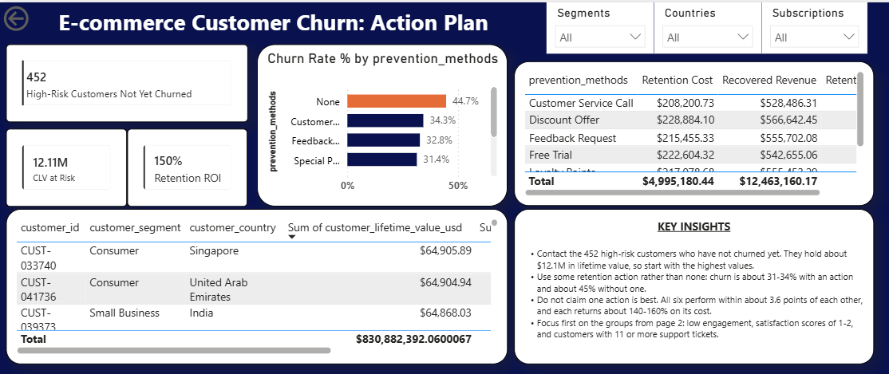

# E-commerce Customer Churn Analysis

**PostgreSQL + Power BI | Portfolio project**

An end-to-end analysis of e-commerce customer churn: loading and cleaning raw data in PostgreSQL, answering business questions with SQL, and presenting the results in a 4-page Power BI report.

> **Author:** Sunidhi Jangid | [LinkedIn](https://www.linkedin.com/in/sunidhi-jangid-625318297) | [Email](mailto:jangidsunidhi82@gmail.com)

## Project Overview
I created this project to analyze customer churn and find out why users stop using a service. I cleaned the dataset to fix missing values and summarized the key drivers behind revenue loss.

---

## 1. Business problem

Customer churn is expensive. About **$207M** of estimated revenue was lost in this dataset. The business needs to know:

1. How big is the churn problem?
2. Why do customers leave?
3. Where does churn happen most (country, segment)?
4. What should we do about it?

---

## 2. Dataset

- **Source:** Kaggle, *E-commerce Customer Churn 2026* ([link](https://www.kaggle.com/datasets/datascikhan/e-commerce-customer-churn-2026))
- **Size:** 50,000 records, 48 columns, **31,644 unique customers** (one customer can have up to 8 records)
- **Split into 3 tables** for the analysis:

| Table | Rows | Content |
|---|---|---|
| `customers` | 31,644 | Segment, country, city, subscription type, customer age, dataset year |
| `Metrics` | 31,644 | Spend, lifetime value, satisfaction, engagement, health score, risk score |
| `Events` | 50,000 | Churn flag and date, churn reason, retention action, marketing and support activity, financial impact |

> The raw CSV is not included in this repository. Please download it from Kaggle.

---

## 3. Tools

| Tool | Use |
|---|---|
| PostgreSQL | Load, clean and analyse the data |
| SQL (CTEs, window functions, aggregates) | EDA and some business questions |
| Power BI and DAX | 4-page interactive report |

---

## 4. Project workflow

| Step | File | What it does |
|---|---|---|
| 1 | `sql/01_create_and_load_data.sql` | Creates the schemas and tables, loads the 3 CSV files |
| 2 | `sql/02_clean_data.sql` | Builds the clean tables |
| 3 | `sql/03_eda.sql` | Exploratory data analysis |
| 4 | `sql/04_business_queries.sql` | 14 business questions, each with a finding and an action |
| 5 | `powerbi/customer_churn.pbix` | Power BI report (4 pages) |

**To reproduce:** run the SQL files in the order above, then export the clean tables to CSV and load them into Power BI.

---

## 5. Data cleaning decisions

| Issue found | What I did |
|---|---|
| Placeholder text ("None", "Not Applicable") in `subscription_type`, `prevention_method`, `churn_reason`, `churn_date` and others | Converted to real `NULL` values where the field was not applicable |
| `churn_date` stored with a useless time part | Converted to a date |
| `marketing_emails_clicked` greater than `marketing_emails_opened` (about 46% of rows, which is impossible) | **Flagged, not deleted** |
| `customer_lifetime_value_usd` lower than `total_spend_usd` (about 12,700 customers) | **Flagged, not deleted** |

---

## 6. Key findings

### Headline numbers

| Metric | Value |
|---|---|
| Record churn rate | **41.3%** (20,653 of 50,000 records) |
| Customers who churned at least once | **50.4%** (15,959 of 31,644) |
| Revenue lost | about **$206.8M** |
| Retention ROI (net) | about **150%** |

### What drives churn

| Driver | Finding |
|---|---|
| Engagement | Low engagement: **61.9%** churn, against about 32.7% for Medium and High (strongest driver) |
| Satisfaction | Scores 1-2: about **60%** churn, against about 30% for scores 3-5 |
| Support tickets | Flat at about 32-34% up to 10 tickets, then **51.8%** for 11 or more |
| Subscription | No subscription: **48.3%**, against about 38-39% on paid plans |
| Churn reasons | Poor Customer Service is the top reason (**18.1%** of churned records), then Better Price Elsewhere (11.0%) |
| Customer health | Churn rises from 33.1% (Excellent) to 76.4% (Poor), but Excellent customers cause about **59%** of revenue lost because they are 74% of all records |

### Where churn happens

- **Country is a weak driver.** All 17 countries churn at **39-43%**.
- **Segment matters more.** Consumer is 43.6% and Premium is 38.5%. Consumer accounts for about 48% of revenue lost.
- Worst country and segment combinations (groups of 200+ records): Canada-Consumer 46.2%, Japan-Small Business 45.8%, Pakistan-Consumer 45.4%.

### What to do

- **452 high-risk customers have not churned yet** and hold about **$12.1M** in lifetime value. Contact the most valuable ones first.
- Any retention action is linked to lower churn: about **31-34%** with an action, against **44.7%** with none. The six actions perform similarly, so none can be ranked as best.
- Focus first on low-engagement customers, satisfaction scores of 1-2, and customers with 11 or more support tickets.

---

## 7. Power BI report

| Page | Question it answers |
|---|---|
| 1. Overview | How big is the churn problem? |
| 2. Churn Drivers | Why do customers leave? |
| 3. Where Churn Happens | Which countries and segments are worst? |
| 4. Action Plan | What should the business do now? |

### Overview


### Churn Drivers


### Where Churn Happens


### Action Plan


A PDF version of the report is in `powerbi/customer_churn_analysis.pdf`.

---

## 8. Skills shown

SQL (joins, CTEs, window functions, CASE, aggregates), data cleaning and validation, data quality flagging, KPI design, DAX measures, Power BI data modelling and dashboard design, business storytelling, and honest reporting of limitations.

---

## 9. Repository structure

```
ecommerce-churn-analysis/
├── README.md
├── sql/
│   ├── 01_create_and_load.sql
│   ├── 02_clean_data.sql
│   ├── 03_eda.sql
│   └── 04_business_queries.sql
├── powerbi/
│   ├── customer_churn.pbix
│   └── customer_churn_analysis.pdf
└── images/
    ├── 01_overview_page.png
    ├── 02_churn_drivers_page.png
    ├── 03_where_churn_happens_page.png
    └── 04_action_plan_page.png
```
